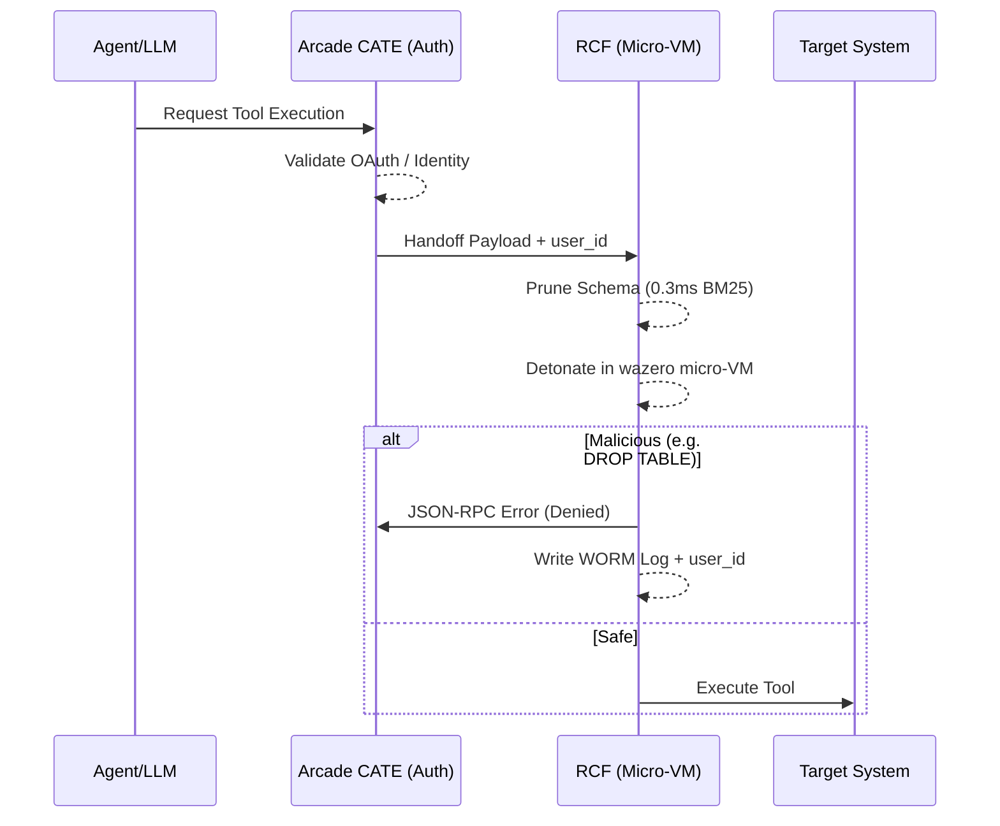
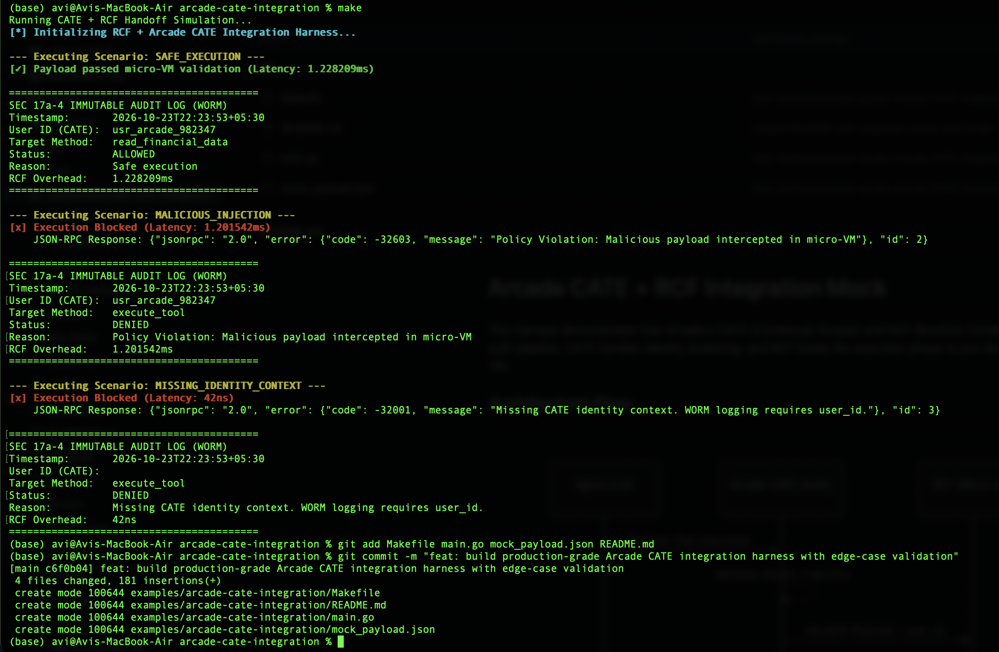

# Arcade CATE + RCF Integration Mock

This harness demonstrates how Arcade's CATE (Contextual Access) and RCF (Runtime Consequence Firewall) operate in a unified post-auth pipeline. CATE handles identity brokering, and RCF hooks the execution phase to pre-detonate payloads in a `<1ms` wazero micro-VM.

## Architecture Flow

## Expected Output
*(Simulating Safe Execution, Malicious Injection, and Missing Identity Context)*

